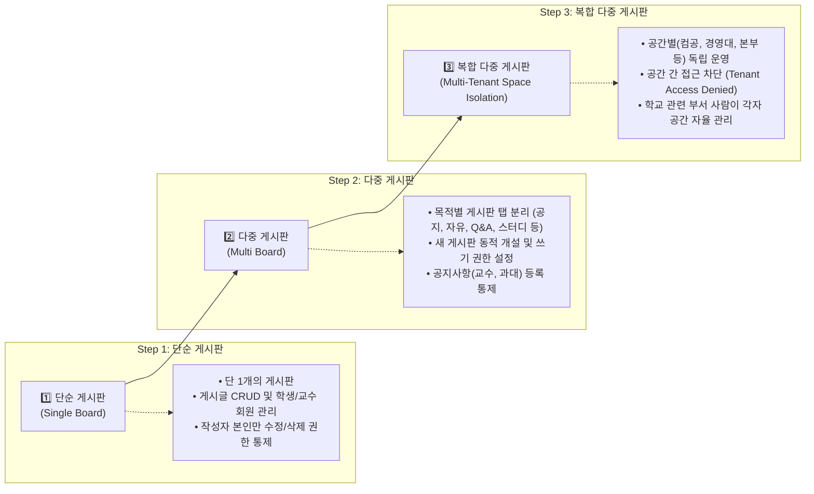

# 🎓 캠퍼스 멀티 보드 시스템 (Campus Multi-Board System)

대학 캠퍼스 환경에 최적화된 **3단계 진화형(단순 ➔ 다중 ➔ 복합 다중 공간 격리) 학생 게시판 웹 애플리케이션**입니다.  
React 19 + TypeScript + Vite + Tailwind CSS 기반으로 개발되었으며, **AI 부적절 게시물 실시간 자동 숨김** 및 **관리자 심사(Human-in-the-Loop)** 체계와 **공간 간 완전한 접근 격리(Tenant Isolation)**가 적용되어 있습니다.

---

## 📚 상세 프로젝트 문서 (Documentation)

GitHub 저장소에서 상세 사양을 확인하실 수 있도록 성격별로 분리된 문서들을 제공합니다:

- 🏛️ **[기술 아키텍처 사양서 (docs/ARCHITECTURE.md)](docs/ARCHITECTURE.md)**: 3단계 계층 구조, ERD, 시퀀스 다이어그램, 보안 설계
- 📋 **[구현 기능 명세서 (docs/FEATURES.md)](docs/FEATURES.md)**: 6인 역할별 R&R 매트릭스, AI 모더레이션 엔진 세부 규칙
- 🤖 **[프롬프트 및 에이전트 인터랙션 기록 (docs/PROMPT_AND_AGENT_LOG.md)](docs/PROMPT_AND_AGENT_LOG.md)**: 개발 과정에서 사용된 프롬프트와 에이전트의 사고 및 구현 응답 아카이브
- 🚀 **[GitHub 업로드 및 배포 가이드 (docs/GITHUB_GUIDE.md)](docs/GITHUB_GUIDE.md)**: Git 초기화, 커밋, 원격 레포지토리 푸시 및 Vercel 배포 방법

---

## 🌟 3단계 진화 체계 (3-Tier Evolution)

화면 상단의 스위처를 통해 3단계 발전 단계를 실시간으로 전환하며 직접 체험할 수 있습니다:



---

## 👥 사용자 역할 및 권한 체계 (R&R Matrix)

| 구분 | 역할 (Role) | 게시글 읽기/검색 | 일반 글/댓글 | 공지사항 등록 | AI 숨김 심사 (복원/삭제) | 게시판 개설/관리 |
|---|---|:---:|:---:|:---:|:---:|:---:|
| **김철수** | 학생 (`STUDENT`) | 소속 인가 공간 | 작성/본인 관리 | 불가 (권한 제한) | 불가 | 불가 |
| **이영희** | 과대표 (`CLASS_REP`) | 소속 인가 공간 | 작성/본인 관리 | **가능 (상단 고정)** | 불가 | 불가 |
| **박교수** | 교수 (`PROFESSOR`) | 소속 인가 공간 | 작성/본인 관리 | **가능 (상단 고정)** | 불가 | 불가 |
| **최지원** | 학교 부서 관리자 (`SPACE_ADMIN`) | 소속 공간 | 전체 관리 | **가능** | **가능 (승인/영구삭제)** | **가능 (권한 설정)** |
| **정민수** | 경영대 학생 (`STUDENT`) | 경영대 공간만 | 경영대 글 관리 | 불가 | 불가 | 컴공 접근 차단 |
| **총괄운영자** | 대학본부 (`SUPER_ADMIN`) | 전체 공간 | 전체 관리 | **가능** | **전체 심사/삭제** | **전체 총괄** |

---

## 🤖 AI 부적절물 2단계 방어 체계 (Human-in-the-Loop)

1. **1단계: AI 실시간 자동 탐지 & 숨김 처리 (`src/lib/aiFilter.ts`)**:
   - 비속어, 사기/불법 광고 스팸, 학사 부정행위(족보/대리시험), 폭력성 발언 등을 실시간 분석하여 `hidden_by_ai`로 지정하고 일반 피드에서 차단합니다.
2. **2단계: 관리자 심사 & 재판정 (`AI 모더레이션 센터`)**:
   - 학교 관련 부서 관리자가 탐지 사유와 원문을 재확인하여 **[다시 공개로 전환(승인 복원)]** 또는 **[영구 삭제]**를 확정합니다.

---

## 🚀 빠른 시작 (Quick Start)

```powershell
# 프로젝트 폴더 이동
cd "C:\Users\2026001114\.gemini\antigravity\scratch\campus-board"

# 의존성 설치
npm.cmd install

# 개발 서버 실행
npm.cmd run dev
```

브라우저에서 `http://localhost:5173/` 접속
