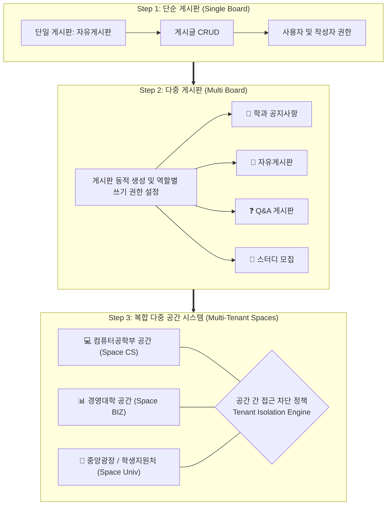
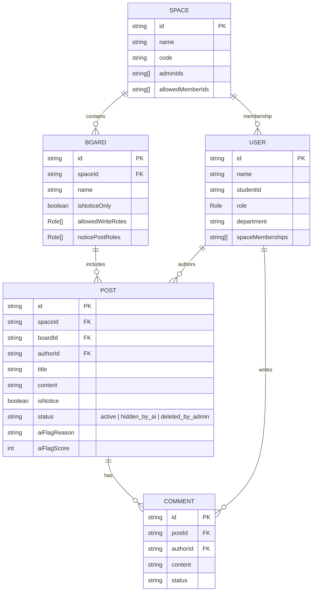
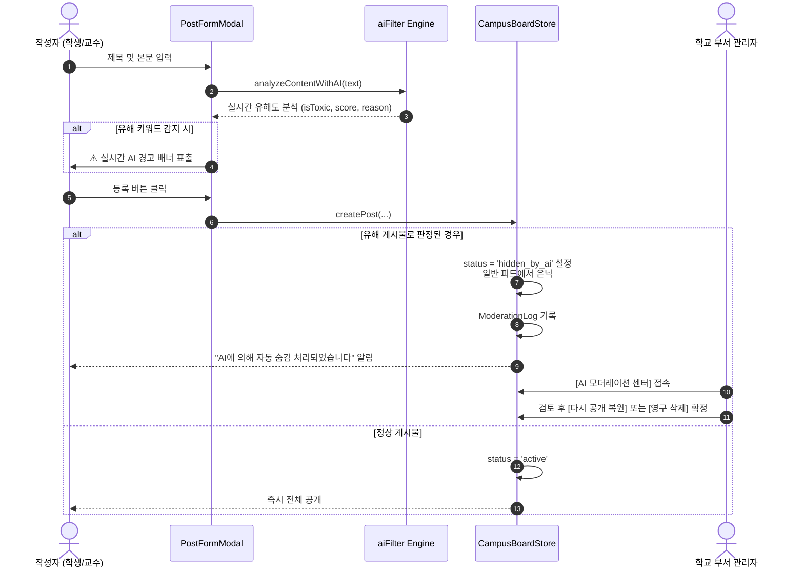

# 🏛️ 캠퍼스 멀티 보드 시스템 기술 아키텍처 사양서 (System Architecture)

본 문서는 **캠퍼스 멀티 보드 시스템(Campus Multi-Board System)**의 설계 원칙, 3단계 확장 체계, 데이터 모델, 테넌트 격리(Tenant Isolation), 그리고 AI 부적절물 탐지 파이프라인을 기술합니다.

---

## 1. 3단계 진화형 아키텍처 개요

본 프로젝트는 단순 게시판에서 출발하여 다중 게시판, 최종적으로 독립된 공간별 멀티 테넌트 게시판으로 확장 가능한 점진적 아키텍처를 채택했습니다.



---

## 2. 계층별 시스템 구조 (Layered Architecture)

```
campus-board/
├── src/
│   ├── types/               # TypeScript 인터페이스 및 열거형 타입
│   │   └── index.ts         # User, Space, Board, Post, Comment, Role
│   ├── lib/                 # 비즈니스 로직 및 코어 모듈
│   │   ├── aiFilter.ts      # AI 유해 콘텐츠 실시간 분석 엔진
│   │   ├── storage.ts       # 데이터 저장소 및 보안/권한 검증 레이어
│   │   └── mockData.ts      # 캠퍼스 표준 시드 데이터 (6인 사용자, 공간, 게시판)
│   ├── components/          # 재사용 가능한 UI 프레젠테이션 컴포넌트
│   │   ├── Header.tsx                 # 사용자 전환 바 & 3단계 모드 스위처
│   │   ├── SpaceNavigation.tsx        # 멀티 테넌트 공간 선택 및 접근 차단
│   │   ├── BoardTabs.tsx              # 다중 게시판 탭 & 관리자 추가 기능
│   │   ├── PostCard.tsx               # 게시글 카드 (공지 뱃지, AI 숨김 태그)
│   │   ├── PostDetailModal.tsx        # 상세 보기, 댓글 관리, 권한별 조치
│   │   ├── PostFormModal.tsx          # 글쓰기/수정, 공지 권한 검증, 실시간 AI 피드백
│   │   ├── ModerationCenterModal.tsx  # AI 모더레이션 센터 (복원/영구삭제)
│   │   ├── BoardManageModal.tsx       # 게시판 개설 및 역할 권한 설정 모달
│   │   └── ArchitectureModal.tsx      # 시스템 아키텍처 대화형 가이드 모달
│   ├── App.tsx              # 전역 상태 바인딩, 필터/검색, 라우팅 뷰 제어
│   ├── main.tsx
│   └── index.css            # Tailwind CSS v4 스타일링
```

---

## 3. 데이터 모델 관계 다이어그램 (ERD)



---

## 4. 핵심 보안 및 권한 정책 (Security & RBAC)

### 4.1 공간 간 접근 차단 (Tenant Isolation)
- `checkSpaceAccess(user: User, spaceId: string): boolean`
- 사용자의 `spaceMemberships`에 대상 `spaceId`가 존재하지 않을 경우, 데이터 패치 및 렌더링을 원천 차단하고 `Tenant Access Denied` 보안 화면을 반환합니다.
- 최고 관리자(`SUPER_ADMIN`)만 전체 공간에 접근 가능한 거버넌스 권한을 부여받습니다.

### 4.2 작성자 권한 및 공지사항 등록 권한
- **게시글/댓글 수정**: 작성자 본인(`post.authorId === user.id`)만 수정 가능
- **게시글/댓글 삭제**: 작성자 본인 또는 해당 공간의 담당 부서 관리자(`isSpaceAdmin`)만 가능
- **공지사항 등록 권한**: 일반 학생은 공지 등록 불가, 오직 `CLASS_REP(과대)`, `PROFESSOR(교수)`, `SPACE_ADMIN(부서 관리자)`, `SUPER_ADMIN(총괄)`에게만 허용

---

## 5. AI 부적절물 자동 필터링 파이프라인


