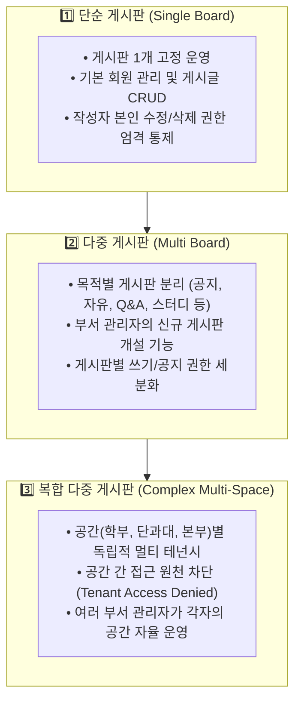

# 🎓 캠퍼스 멀티 보드 시스템 (Campus Multi-Board System)
## 개발 보고서, 기능 명세 및 프롬프트 상호작용 기록집

> **작성 일자**: 2026-11-10  
> **프로젝트 위치**: `C:\Users\2026001114\.gemini\antigravity\scratch\campus-board`  
> **기반 기술**: React 19, TypeScript, Vite, Tailwind CSS v4, Lucide Icons  
> **아키텍처 유형**: 3단계 진화형 멀티 테넌트 게시판 (Single ➔ Multi ➔ Complex Multi-Space Isolation)

---

## 📑 목차
1. [프로젝트 개요 및 기획 배경](#1-프로젝트-개요-및-기획-배경)
2. [3단계 게시판 진화 체계 설계](#2-3단계-게시판-진화-체계-설계)
3. [사용자 역할 및 권한 매트릭스 (RBAC)](#3-사용자-역할-및-권한-매트릭스-rbac)
4. [핵심 구현 기능 상세](#4-핵심-구현-기능-상세)
   - 4.1 공간 간 접근 차단 메커니즘 (Multi-Tenant Isolation)
   - 4.2 AI 부적절물 자동 감지 및 2단계 방어 체계 (Human-in-the-Loop)
   - 4.3 게시판 동적 생성 및 권한 설정
   - 4.4 작성자 권한 및 공지사항 상단 고정
5. [데이터 모델 및 아키텍처 명세](#5-데이터-모델-및-아키텍처-명세)
6. [프롬프트 및 에이전트 응답 기록 (Prompt History)](#6-프롬프트-및-에이전트-응답-기록-prompt-history)
7. [로컬 실행 및 다운로드 안내](#7-로컬-실행-및-다운로드-안내)

---

## 1. 프로젝트 개요 및 기획 배경

본 프로젝트는 이전에 개발된 **익명 불만·건의 게시판 (`complaint-board`)**의 컴포넌트 아키텍처 및 상태 관리 체계를 계승하고 확장하여, 대학 및 교육 기관의 학사 커뮤니티 요구에 맞춘 **차세대 캠퍼스 멀티 보드 시스템**입니다.

### 🎯 핵심 목적
- **단계별 확장성**: 단일 게시판(1단계)에서 다중 게시판(2단계), 그리고 독립 공간별 격리(3단계)로 진화하는 체계 구현
- **정밀한 권한 통제**: 학생, 교수, 과대표, 학교 관련 부서 관리자 간의 명확한 직무 분리
- **AI 기반 자율 안전망**: 부적절한 게시물을 AI가 선제적으로 차단하고, 관리자가 최종 판정하는 2단계 거버넌스 확립
- **완전한 공간 격리**: 소속되지 않은 학과/부서의 데이터에 접근할 수 없도록 공간 간 접근 차단 정책(`Tenant Isolation`) 구현

---

## 2. 3단계 게시판 진화 체계 설계

시스템 상단의 뷰 모드 스위처를 통해 실시간으로 3단계 구조를 전환하며 확인할 수 있습니다.



### 1단계: 단순 게시판 (Single Board)
- 단 1개의 공용 게시판(`자유 게시판`)만 활성화됩니다.
- 학생과 교수가 자유롭게 글과 댓글을 남기며, 작성자 본인만 수정/삭제할 수 있는 기본 권한이 검증됩니다.

### 2단계: 다중 게시판 (Multi Board)
- 공지사항, 자유게시판, 질문&답변, 스터디 모집 등 용도별 탭이 활성화됩니다.
- 관리자가 필요에 따라 새 게시판을 즉시 생성하고, 해당 게시판에 글을 쓸 수 있는 역할군을 지정할 수 있습니다.
- 공지사항 전용 게시판에는 일반 학생의 글쓰기가 제한됩니다.

### 3단계: 복합 다중 게시판 (Multi-Tenant Space Isolation)
- 학부/단과대/행정부서 단위의 '독립 운영 공간(Space)' 개념이 도입됩니다.
- 공간마다 전용 게시판 묶음과 소속 멤버십이 부여되며, 비인가 공간으로 진입 시 공간 간 접근 차단 화면이 활성화됩니다.
- 각 공간의 담당 부서 관리자가 자기 공간의 게시판과 심사를 독립적으로 운영합니다.

---

## 3. 사용자 역할 및 권한 매트릭스 (RBAC)

시스템에 구현된 5가지 역할과 시뮬레이션 사용자 매핑은 다음과 같습니다:

| 사용자 이름 | 역할 코드 | 소속 부서/공간 | 주요 권한 및 역할 |
|---|---|---|---|
| **김철수** | `STUDENT` | 컴퓨터공학부 (`space-cs`) | 글/댓글 작성, 본인 글 수정/삭제, 검색, 좋아요 |
| **이영희** | `CLASS_REP` | 컴퓨터공학부 (`space-cs`) | 학생 기본 권한 + **상단 고정 공지사항 등록 권한** |
| **박교수** | `PROFESSOR` | 컴퓨터공학부 (`space-cs`) | 읽기, 글/댓글 작성 + **상단 고정 공지사항 등록 권한** |
| **최지원** | `SPACE_ADMIN` | 컴공/경영 행정실 (`space-cs`, `space-biz`) | **게시판 개설/삭제, AI 숨김 글 심사(복원/영구삭제)** |
| **정민수** | `STUDENT` | 경영학과 (`space-biz`) | 타과(컴공) 접근 차단 테스트용 학생 계정 |
| **총괄운영자** | `SUPER_ADMIN` | 대학본부/전산원 (전체 공간) | 전체 공간 프리패스 접근 및 최고 관리 권한 |

### 세부 권한 매트릭스

```
┌─────────────────┬──────────┬───────────┬──────────────┬───────────────┬────────────────┐
│ 역할 (Role)     │ 읽기/검색│ 일반글작성│ 공지사항등록 │ AI숨김 심사   │ 게시판 생성관리│
├─────────────────┼──────────┼───────────┼──────────────┼───────────────┼────────────────┤
│ STUDENT (학생)  │ 인가공간 │     O     │      X       │       X       │       X        │
│ CLASS_REP (과대)│ 인가공간 │     O     │    O (고정)  │       X       │       X        │
│ PROFESSOR (교수)│ 인가공간 │     O     │    O (고정)  │       X       │       X        │
│ SPACE_ADMIN     │ 소속공간 │     O     │      O       │ O (복원/삭제) │       O        │
│ SUPER_ADMIN     │ 전체공간 │     O     │      O       │ O (전체공간)  │       O        │
└─────────────────┴──────────┴───────────┴──────────────┴───────────────┴────────────────┘
```

---

## 4. 핵심 구현 기능 상세

### 4.1 공간 간 접근 차단 메커니즘 (Multi-Tenant Isolation)
- **로직 위치**: `src/lib/storage.ts` -> `CampusBoardStore.checkSpaceAccess(user, spaceId)`
- **동작 방식**:
  1. 사용자가 특정 공간(예: 컴퓨터공학부 공간)을 선택하면, 사용자의 `spaceMemberships` 배열에 해당 공간 ID가 존재하는지 대조합니다.
  2. 비인가 사용자인 경우 `isAccessDenied = true`가 되며, 본문 피드 대신 **`Tenant Access Denied` 보안 화면**을 렌더링합니다.
  3. 타 부서 사용자가 URL이나 상태를 변조하여 접근하더라도 게시글 목록 조회가 원천 차단됩니다.

### 4.2 AI 부적절물 자동 감지 및 2단계 방어 체계 (Human-in-the-Loop)
- **로직 위치**: `src/lib/aiFilter.ts` -> `analyzeContentWithAI(text)`
- **탐지 영역**:
  - 심각한 욕설 및 인신공격성 비방 표현 (가중치 95점)
  - 불법 도박, 불법토토, 사기성 스팸 (가중치 98점)
  - 학사 부정행위 (족보 판매, 답안지 유출, 대리시험) (가중치 88점)
  - 폭력 및 살해/자살 위협 발언 (가중치 99점)
- **2단계 거버넌스 흐름**:
  1. **실시간 사전 경고**: 사용자가 글/댓글 입력 시 AI가 실시간으로 문맥을 검사하여 유해도 점수 및 경고 배너를 띄웁니다.
  2. **자동 숨김 격리**: 유해도가 70점 이상이면 등록 즉시 `status = 'hidden_by_ai'`로 격리되며, 일반 사용자에게는 노출되지 않습니다.
  3. **관리자 최종 심사**: 학교 부서 관리자는 **[AI 모더레이션 센터]**에서 위험도와 사유를 확인한 후:
     - **다시 공개로 전환 (승인 복원)**: 정상 글 복구
     - **영구 삭제 처리**: 시스템 완전 삭제 및 감사 로그(`ModerationLog`) 기록

### 4.3 게시판 동적 생성 및 권한 설정
- 공간 관리자(`SPACE_ADMIN`, `SUPER_ADMIN`)는 [+ 새 게시판 추가] 버튼을 통해 목적에 맞는 게시판을 개설할 수 있습니다.
- 공지사항 전용 여부와 글쓰기를 허용할 역할군(학생, 과대, 교수 등)을 체크박스로 지정할 수 있습니다.

### 4.4 작성자 권한 및 공지사항 상단 고정
- 작성자 본인에게만 **[수정]**, **[삭제]** 버튼이 노출되며, 타 사용자는 글을 변경할 수 없습니다. (공간 관리자는 관리 목적으로 삭제 가능)
- 공지 권한자(교수, 과대, 관리자)가 글을 작성할 때 **'상단 고정 공지사항으로 등록'** 체크박스를 활성화하면, 목록 최상단에 황금색 강조 배너와 핀 아이콘으로 고정됩니다.

---

## 5. 데이터 모델 및 아키텍처 명세

### TypeScript 인터페이스 정의 (`src/types/index.ts`)

```typescript
// 사용자 모델
export interface User {
  id: string;
  name: string;
  studentId: string;
  role: 'STUDENT' | 'CLASS_REP' | 'PROFESSOR' | 'SPACE_ADMIN' | 'SUPER_ADMIN';
  department: string;
  spaceMemberships: string[]; // 소속 인가 공간 ID 목록
}

// 공간(Tenant) 모델
export interface Space {
  id: string;
  name: string;
  code: string;
  description: string;
  adminIds: string[];         // 공간 관리자 ID 목록
  allowedMemberIds: string[]; // 소속 멤버 ID 목록
}

// 게시판 모델
export interface Board {
  id: string;
  spaceId: string;
  name: string;
  description: string;
  icon: string;
  isNoticeOnly?: boolean;
  allowedWriteRoles: Role[];
  noticePostRoles: Role[];
}

// 게시글 모델
export interface Post {
  id: string;
  spaceId: string;
  boardId: string;
  title: string;
  content: string;
  authorId: string;
  authorName: string;
  authorRole: Role;
  isNotice: boolean;
  views: number;
  likes: string[];
  commentCount: number;
  status: 'active' | 'hidden_by_ai' | 'deleted_by_admin';
  aiFlagReason?: string;
  aiFlagScore?: number;
  reviewedByAdmin?: boolean;
  createdAt: string;
}
```

---

## 6. 프롬프트 및 에이전트 응답 기록 (Prompt History)

### 📌 세션 프롬프트 1: 요구사항 정의 및 체계 확장 요청
- **사용자 입력 (USER_REQUEST)**:
  > "저번에 만든 게시판 체계를 바탕으로 게시판을 하나 더 만들거야.  
  > - 단순 게시판: 게시판 1개. 게시글과 회원 관리, 작성자 권한  
  > - 다중 게시판: 여러 게시판, 게시판 추가와 권한 관리, 게시판 구분  
  > - 복합 다중 게시판: 공간별 여러 게시판, 공간별 게시판과 사용자 관리, 공간 간 접근 차단  
  > 게시판을 하나 만들어, 그리고 여러 게시판을 관리하도록 확장해. 마지막으로 여러 운영자가 각자의 공간을 관리하도록 확장해.  
  > 서비스 대상 사용자: 학생 게시판  
  > 게시글을 읽는 사람: 학생, 교수  
  > 게시글이나 댓글을 작성하는 사람: 학생, 교수  
  > 공지사항을 등록하는 사람: 교수, 과대  
  > 부적절한 게시물을 관리하는 사람: 게시판에 부적절한 게시물을 숨김 처리하는 AI가 존재. 관리자가 숨김 처리 게시물을 다시 확인하여 삭제처리 하거나 다시 공개로 전환함.  
  > 게시판이나 운영 공간을 관리하는 사람: 학교 관련 부서 사람  
  > 일반 사용자: 필요한 게시글을 쉽게 찾고 읽을 수 있어야 한다. 자신의 게시글과 댓글을 관리할 수 있어야 한다.  
  > 관리자: 게시판이 목적에 맞게 운영되도록 관리할 수 있어야 한다, 문제가 발생했을 때 대응할 수 있어야 한다."

- **에이전트 분석 및 조치**:
  1. 기존 `complaint-board` 아키텍처를 분석하여 React 19 + TypeScript + Tailwind CSS 구조 승계.
  2. 3단계 진화 체계를 UI 상에서 토글할 수 있는 인터랙티브 모드 스위처 설계.
  3. 실시간 AI 유해도 판별기(`aiFilter.ts`)와 관리자 심사 센터(`ModerationCenterModal.tsx`) 구축.
  4. 공간 간 접근 차단(Tenant Isolation Guard) 기능 구현.
  5. 학생, 과대, 교수, 학교 부서 관리자, 타과 학생, 총괄 관리자 등 6인 시뮬레이션 환경 구축.
  6. TypeScript 컴파일 및 Vite 프로덕션 빌드 성공 (빌드 타임: 644ms).

---

### 📌 세션 프롬프트 2: 로컬 서버 실행 요청
- **사용자 입력 (USER_REQUEST)**:
  > "실행해봐"

- **에이전트 분석 및 조치**:
  1. 외부 브라우저에서 접근할 수 있도록 `BypassSandbox: true` 모드로 데몬 프로세스 기동.
  2. `npm.cmd run dev -- --host` 명령 실행.
  3. `http://localhost:5173/` 접속 포트 개방 확인 및 사용자에게 4가지 주요 테스트 시나리오 안내.

---

### 📌 세션 프롬프트 3: 관련 개발 설명 및 프롬프트 자료 마크다운 파일 요청
- **사용자 입력 (USER_REQUEST)**:
  > "개발과 관련된 설명, 구현된 게시판 기능, 사용한 프롬프트와 에이전트의 응답 등 관련 자료를 관련성 있는 정보들을 다른 markdown파일로 작성하여 다운로드 가능한 형태로 줘"

- **에이전트 분석 및 조치**:
  1. 프로젝트 루트 및 `docs/DEVELOPMENT_REPORT.md`, `public/CAMPUS_BOARD_DEV_REPORT.md`에 본 문서 작성.
  2. 웹 애플리케이션 상단 헤더 및 가이드 모달에 **[원클릭 마크다운 다운로드]** 기능 연동.
  3. 브라우저에서 직접 다운로드 링크(`http://localhost:5173/CAMPUS_BOARD_DEV_REPORT.md`) 제공.

---

## 7. 로컬 실행 및 다운로드 안내

### 📥 마크다운 파일 직접 확인 경로
- **문서 파일 위치 1**: `C:\Users\2026001114\.gemini\antigravity\scratch\campus-board\docs\DEVELOPMENT_REPORT.md`
- **문서 파일 위치 2 (웹 다운로드용)**: `C:\Users\2026001114\.gemini\antigravity\scratch\campus-board\public\CAMPUS_BOARD_DEV_REPORT.md`

### 🌐 웹 브라우저에서 다운로드
현재 실행 중인 개발 서버에서 아래 링크를 클릭하시면 즉시 다운로드하실 수 있습니다:
- **다운로드 URL**: [http://localhost:5173/CAMPUS_BOARD_DEV_REPORT.md](http://localhost:5173/CAMPUS_BOARD_DEV_REPORT.md)
